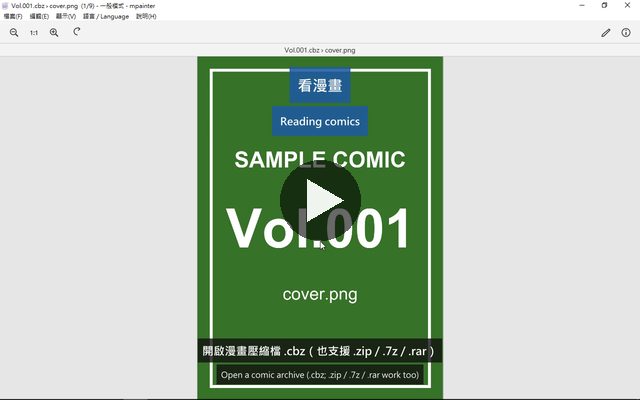
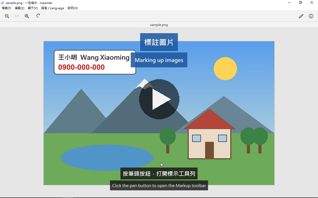
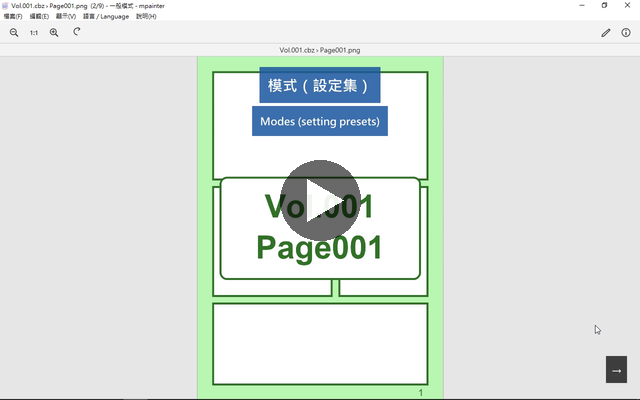

# mini-painter (mpainter)


A small, fast image viewer and annotator for Windows, in the spirit of macOS Preview.
Single portable `mpainter.exe`, no runtime to install.

輕量、秒開的 Windows 圖片檢視與標註工具，以 macOS Preview 為範本。單一免安裝的 `mpainter.exe`，不需要 Visual C++ 可轉散發套件。

## Features / 功能

- BMP, TIFF, JPEG, PNG, WebP. Arrow keys page through a folder; zip / 7z / rar (cbz / cb7 / cbr) archives open as if they were folders, encrypted ones included.
- Annotations as vector objects until you save: sketch, lines and arrows, shapes, speech bubbles, magnifier, mosaic, text. Multi-level undo.
- Adjust color (levels, exposure, white balance, …), adjust size (Lanczos3) and crop. Saving keeps EXIF / XMP / ICC.
- View modes for reading: fit to window / width / height, actual size, two pages side by side (right-to-left for manga), continue to the next folder or archive at the end.
- Modes (named sets of viewing settings) switchable from the View menu; the title bar always shows the current one.
- UI in English and Traditional Chinese built in; Japanese and other languages via `lang/*.txt`.
- Checks GitHub for a new version at start (can be turned off) and updates itself in place: download, verify, replace, restart.

- 支援 BMP、TIFF、JPEG、PNG、WebP；方向鍵翻同資料夾；zip / 7z / rar（cbz / cb7 / cbr）壓縮檔直接當資料夾翻，含加密檔。
- 標註是向量物件，存檔才壓成像素：塗鴉、直線與箭頭、形狀、對話框、放大鏡、馬賽克、文字；多層復原。
- 調整顏色（色階、曝光、白平衡…）、調整尺寸（Lanczos3）與裁切；存檔保留 EXIF / XMP / ICC。
- 看漫畫的檢視模式：符合視窗 / 寬度 / 高度、實際大小、兩頁並排（可由右到左）、翻到底接著看下一本。
- 「模式」= 一組有名字的檢視設定，在「顯示 › 模式」一鍵切換，標題列永遠顯示目前的模式。
- 介面內建英文與繁體中文，日文與其他語言放 `lang/*.txt`。
- 啟動時查 GitHub 有沒有新版（可關閉），一鍵更新：下載、核對、換檔、自動重開。

Usage details are in [readme.txt](readme.txt) (中文) and [readme_en.txt](readme_en.txt) (English); both ship next to the exe.

## Videos / 教學影片

Traditional Chinese UI with Chinese and English subtitles. Click a picture to play.

繁中介面，中英雙語字幕。點圖播放。

| Reading comics · 看漫畫 (0:41) | Marking up images · 標註圖片 (0:58) | Modes · 模式 (1:04) |
|:---:|:---:|:---:|
| [](https://livid.com/watch/S_23UjAK9UuU) | [](https://livid.com/watch/fNybBc7yjcfj) | [](https://livid.com/watch/1PbhclUnaPT9) |

## Download / 下載

Grab the latest `mini-painter-<version>-win64.zip` from the [Releases](../../releases) page. It contains `mpainter.exe`, `7z.dll` (7-Zip's component, only needed for archives), the readmes, licenses and `lang/`.

## Build / 建置

Requirements: Visual Studio 2022 Build Tools (MSVC x64 + Windows SDK), CMake ≥ 3.25, Ninja, [vcpkg](https://github.com/microsoft/vcpkg) (manifest mode; the baseline is pinned in `vcpkg.json`), Python 3 (only for `scripts/lang_check.py`).

```bat
call "C:\Program Files (x86)\Microsoft Visual Studio\2022\BuildTools\VC\Auxiliary\Build\vcvars64.bat"
cmake -S . -B build -G Ninja -DCMAKE_BUILD_TYPE=Release ^
  -DCMAKE_TOOLCHAIN_FILE=%VCPKG_ROOT%\scripts\buildsystems\vcpkg.cmake ^
  -DVCPKG_TARGET_TRIPLET=x64-windows-static ^
  -DMP_7Z_DLL=C:\path\to\7z.dll
cmake --build build
build\mp_tests.exe
```

- `MP_7Z_DLL` points at the official `7z.dll` from the 7-Zip release pinned in `scripts/7zip.lock`; it is copied next to the exe and the test binary after the build. Without it the program runs but cannot open archives, and `test_archive` fails.
- Everything is statically linked (`/MT`); the only DLL is the optional `7z.dll`, loaded at run time.
- `scripts/` holds the maintainers' helpers: `vm-sync.sh` / `vm-build.cmd` build on a Windows VM over SSH, `package.sh` assembles the release folder, `make_rar_fixtures.cmd` regenerates the rar test files, `lang_check.py` checks that every UI string has a translation entry.

CI (`.github/workflows/build.yml`) does the same on `windows-latest` for every push and pull request. Pushing a tag `vX.Y.Z` that matches `project(VERSION …)` in `CMakeLists.txt` (and `version-string` in `vcpkg.json`; CI checks both) builds, tests and publishes a GitHub Release with the zip and the matching 7-Zip source archive.

## License / 授權

Apache License 2.0, © Mini Painter Contributors. See [LICENSE](LICENSE) and [NOTICE](NOTICE).

Third-party components: libwebp (BSD-3-Clause), bit7z (MPL 2.0), 7-Zip's `7z.dll` (LGPL 2.1 + unRAR restriction; loaded at run time, replaceable by the user, source archive attached to every release). Details in [THIRD-PARTY-NOTICES.txt](THIRD-PARTY-NOTICES.txt).
