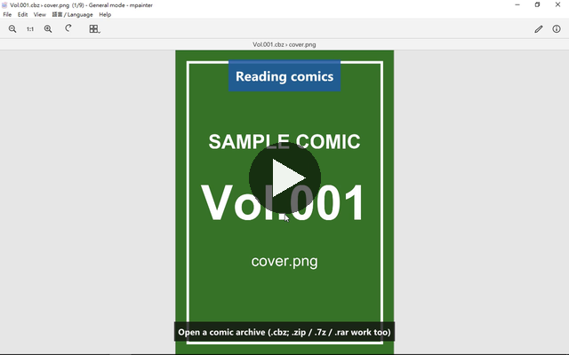
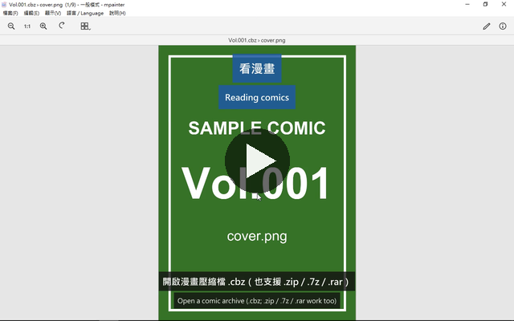
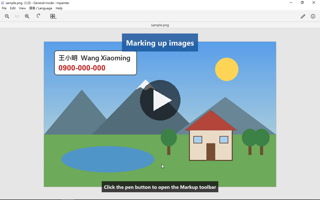
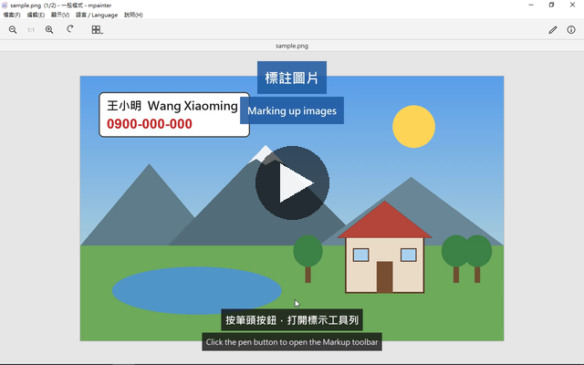
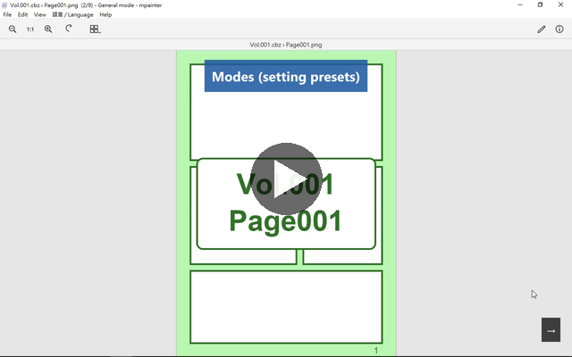
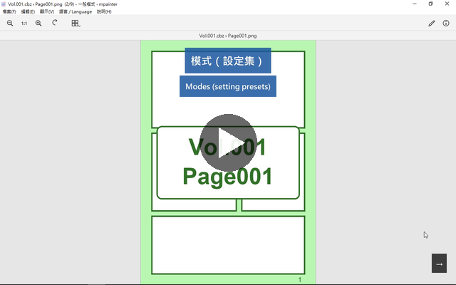
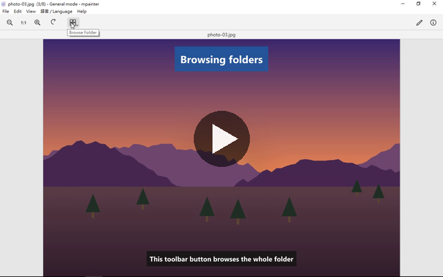
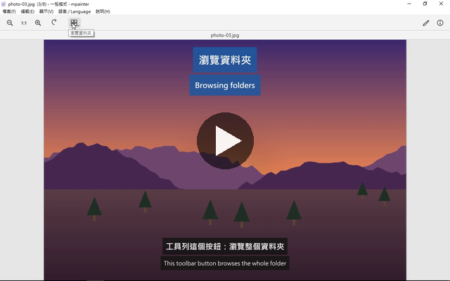
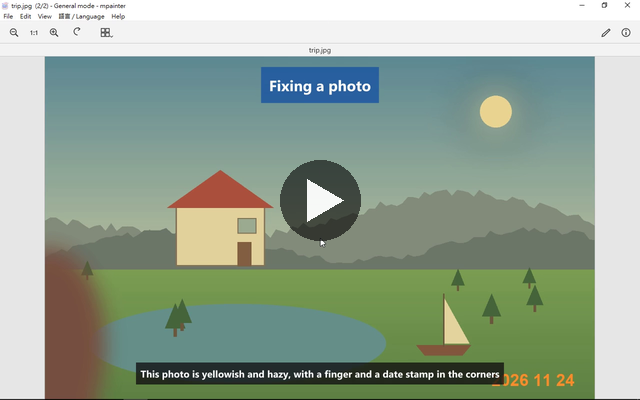
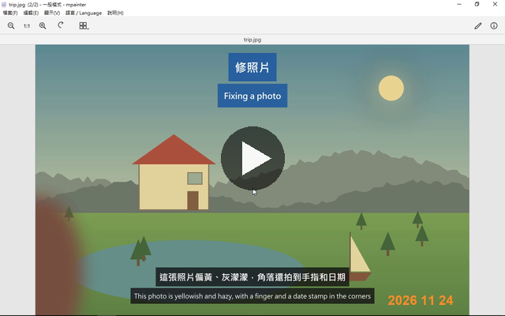

# mini-painter (mpainter)


A small, fast image viewer and annotator for Windows, in the spirit of macOS Preview.
Single portable `mpainter.exe`, no runtime to install.

輕量、秒開的 Windows 圖片檢視與標註工具，以 macOS Preview 為範本。單一免安裝的 `mpainter.exe`，不需要 Visual C++ 可轉散發套件。

## Features / 功能

- BMP, TIFF, JPEG, PNG, WebP; through the bundled plugins also JPEG XL and DNG (camera raw), view and export only. HEIC / HEIF through Windows once the Microsoft Store extensions are installed, view and export only. Arrow keys page through a folder; zip / 7z / rar (cbz / cb7 / cbr) archives open as if they were folders, encrypted ones included.
- Browse Folder: a folder tree, thumbnails of the subfolders, archives and images in a folder, and a preview with size, bit depth, file size and date. Thumbnails come from the Windows thumbnail cache when it has them; the rest are made quickly and kept in a small SQLite cache.
- Annotations as vector objects until you save: sketch, lines and arrows, shapes, speech bubbles, magnifier, mosaic, text. Multi-level undo.
- Adjust color (levels, exposure, white balance, …), adjust size (Lanczos3) and crop. Saving keeps EXIF / XMP / ICC.
- View modes for reading: fit to window / width / height, actual size, two pages side by side (right-to-left for manga), continue to the next folder or archive at the end.
- Modes (named sets of viewing settings) switchable from the View menu; the title bar always shows the current one.
- UI in English and Traditional Chinese built in; Japanese and other languages via `lang/*.txt`.
- Checks GitHub for a new version at start (can be turned off) and updates itself in place: download, verify, replace, restart.
- Image plugins add formats to open through a small C interface: see [src/plugins/README.md](src/plugins/README.md). An image opened through a plugin is read-only: view it, or export a copy in one of the formats above. A plugin that crashes mpainter is turned off at the next start.

- 支援 BMP、TIFF、JPEG、PNG、WebP，隨附的 plugin 再加 JPEG XL 與 DNG（相機 raw 檔），這兩種只能看與輸出成；HEIC / HEIF 裝了 Microsoft Store 的擴充後交給 Windows 解，也只能看與輸出成；方向鍵翻同資料夾；zip / 7z / rar（cbz / cb7 / cbr）壓縮檔直接當資料夾翻，含加密檔。
- 瀏覽資料夾：資料夾樹、這一層的子資料夾、壓縮檔與圖片的縮圖、預覽（尺寸、色深、檔案大小、日期）。縮圖先用 Windows 的縮圖快取，沒有的自己快速算，存在小小的 SQLite 快取裡。
- 標註是向量物件，存檔才壓成像素：塗鴉、直線與箭頭、形狀、對話框、放大鏡、馬賽克、文字；多層復原。
- 調整顏色（色階、曝光、白平衡…）、調整尺寸（Lanczos3）與裁切；存檔保留 EXIF / XMP / ICC。
- 看漫畫的檢視模式：符合視窗 / 寬度 / 高度、實際大小、兩頁並排（可由右到左）、翻到底接著看下一本。
- 「模式」= 一組有名字的檢視設定，在「顯示 › 模式」一鍵切換，標題列永遠顯示目前的模式。
- 介面內建英文與繁體中文，日文與其他語言放 `lang/*.txt`。
- 啟動時查 GitHub 有沒有新版（可關閉），一鍵更新：下載、核對、換檔、自動重開。
- 讀圖 plugin 可以多開別的格式，介面是一個小小的 C 標頭，說明見 [src/plugins/README.md](src/plugins/README.md)（英文）。plugin 開的圖是唯讀的：只能看，或「輸出成」上面的格式。plugin 讓程式當掉時，下次啟動會停用它。

Usage details are in [readme.txt](readme.txt) (中文) and [readme_en.txt](readme_en.txt) (English); both ship next to the exe.

## Videos / 教學影片

Each topic comes in two versions: English UI with English subtitles, and Traditional Chinese UI with Chinese and English subtitles. Click a picture to play. In *Browsing folders*, the folder tree and dates come from Windows, which is Chinese on the recording PC.

每個主題有兩個版本：英文介面配英文字幕，繁中介面配中英雙語字幕。點圖播放。

| | English UI | 繁中介面 |
|---|:---:|:---:|
| **Reading comics**<br>看漫畫 | [](https://livid.com/watch/8vhxkxbv7f2k)<br>0:41 | [](https://livid.com/watch/zBQh7HW2urtD)<br>0:40 |
| **Marking up images**<br>標註圖片 | [](https://livid.com/watch/RLTtOFZWSlEz)<br>0:58 | [](https://livid.com/watch/C9nCyyNqVT_p)<br>0:58 |
| **Modes**<br>模式 | [](https://livid.com/watch/yeD8ShjwAft9)<br>1:05 | [](https://livid.com/watch/8JunuW8QfkmD)<br>1:04 |
| **Browsing folders**<br>瀏覽資料夾 | [](https://livid.com/watch/Hq7FFhtwysBS)<br>0:51 | [](https://livid.com/watch/u9RU_S_tExQS)<br>0:51 |
| **Fixing a photo**<br>修照片 | [](https://livid.com/watch/qiaHePx7aSQk)<br>0:52 | [](https://livid.com/watch/9HRK6jegEWmw)<br>0:52 |

## Download / 下載

Grab the latest `mini-painter-<version>-win64.zip` from the [Releases](../../releases) page. It contains `mpainter.exe`, `7z.dll` (7-Zip's component, only needed for archives), `plugins/jxl/` and `plugins/dng/` (the JPEG XL and DNG plugins), the readmes, licenses and `lang/`.

## Build / 建置

Requirements: Visual Studio 2022 Build Tools (MSVC x64 + Windows SDK), CMake ≥ 3.25, Ninja, [vcpkg](https://github.com/microsoft/vcpkg) (manifest mode; the baseline is pinned in `vcpkg.json`), Python 3 (only for `scripts/lang_check.py`).

```bat
call "C:\Program Files (x86)\Microsoft Visual Studio\2022\BuildTools\VC\Auxiliary\Build\vcvars64.bat"
set VCPKG_ROOT=C:/path/to/vcpkg
set MP_7Z_DLL=C:/path/to/7z.dll
cmake --preset release
cmake --build --preset release
ctest --preset release
python scripts/lang_check.py
```

- The build settings live in `CMakePresets.json` (preset `release`: Ninja, Release, triplet `x64-windows-static`, output in `build/`). CI and the maintainers' VM script use the same preset.
- `MP_7Z_DLL` points at the official `7z.dll` from the 7-Zip release pinned in `scripts/7zip.lock`; it is copied next to the exe and the test binary after the build. Without it the program runs but cannot open archives, and `test_archive` fails.
- Everything is statically linked (`/MT`); the only DLLs are the optional `7z.dll` and the plugins under `plugins/`, both loaded at run time. The JPEG XL plugin (`mp_plugin_jxl`, built to `build/plugins/jxl/jxl.dll`) links libjxl from vcpkg statically. The DNG plugin (`mp_plugin_dng`, built to `build/plugins/dng/dng.dll`) links the Adobe DNG SDK, whose source is in `src/third_party/dng_sdk` (changes for mpainter listed in its `MODIFICATIONS.txt`), plus zlib and libjxl from vcpkg.
- `scripts/` holds the maintainers' helpers: `vm-sync.sh` / `vm-build.cmd` build on a Windows VM over SSH, `package.sh` assembles the release folder, `make_rar_fixtures.cmd` regenerates the rar test files, `lang_check.py` checks that every UI string has a translation entry.

CI (`.github/workflows/build.yml`) does the same on `windows-latest` for every push and pull request. Pushing a tag `vX.Y.Z` that matches `project(VERSION …)` in `CMakeLists.txt` (and `version-string` in `vcpkg.json`; the CMake configure step fails when the two differ) builds, tests and publishes a GitHub Release with the zip and the matching 7-Zip source archive.

## License / 授權

Apache License 2.0, © Mini Painter Contributors. See [LICENSE](LICENSE) and [NOTICE](NOTICE).

Third-party components: libwebp (BSD-3-Clause), bit7z (MPL 2.0), nlohmann/json (MIT), SQLite (public domain), 7-Zip's `7z.dll` (LGPL 2.1 + unRAR restriction; loaded at run time, replaceable by the user, source archive attached to every release). The JPEG XL plugin: libjxl (BSD-3-Clause + patent grant), Highway (BSD-3-Clause), Brotli and Little CMS (MIT). The DNG plugin: the Adobe DNG SDK (DNG SDK License Agreement, [src/third_party/dng_sdk/LICENSE.txt](src/third_party/dng_sdk/LICENSE.txt)), the libjpeg that comes with it (IJG) and zlib, plus the same libjxl, Highway, Brotli and Little CMS. Details in [THIRD-PARTY-NOTICES.txt](THIRD-PARTY-NOTICES.txt).

This product includes DNG technology under license by Adobe. This software is based in part on the work of the Independent JPEG Group.
